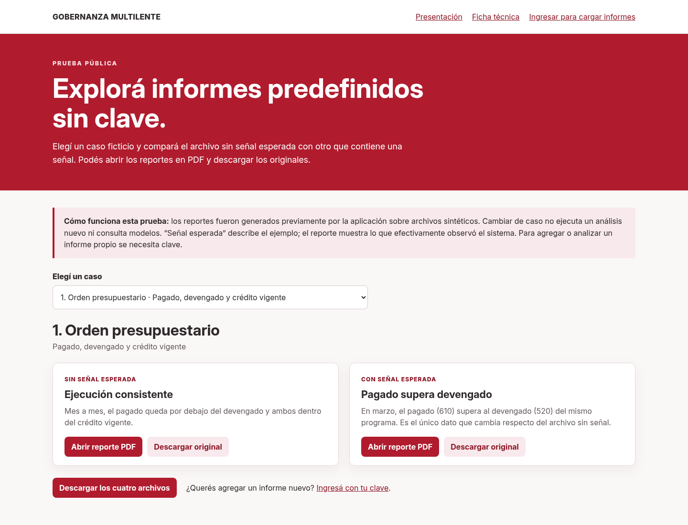
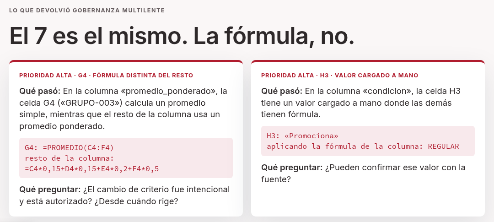

*Esta herramienta digital forma parte del catálogo de herramientas del **Banco Interamericano de Desarrollo**. Puedes conocer más sobre la iniciativa del BID en [https://knowledge.iadb.org/es/codigo-para-el-desarrollo](https://knowledge.iadb.org/es/codigo-para-el-desarrollo).*

<h1 align="center">Gobernanza Multilente</h1>
<p align="center"><b>Una segunda lectura antes de decidir.</b></p>
<p align="center"></p>

## Tabla de contenidos:
---

- [Badges o escudos](#badges-o-escudos)
- [Descripción y contexto](#descripción-y-contexto)
- [Guía de usuario](#guía-de-usuario)
- [Guía de instalación](#guía-de-instalación)
- [Cómo contribuir](#cómo-contribuir)
- [Código de conducta](#código-de-conducta)
- [Autor/es](#autores)
- [Información adicional](#información-adicional)
- [Licencia](#licencia)

## Badges o escudos
---


<!-- Al publicar el repositorio, reemplazar ORGANIZACION_PROYECTO por la clave de SonarCloud:
[](https://sonarcloud.io/summary/new_code?id=ORGANIZACION_PROYECTO)
-->

## Descripción y contexto
---

Quien decide casi nunca tiene tiempo de revisar a fondo los informes que le llegan: totales que vienen
de otros totales, series de varios años, cuadros con decenas de hojas. Un total que no cierra, una serie
que cambió de criterio o un programa que ejecutó casi todo su presupuesto con pocas metas cumplidas
pueden pasar inadvertidos.

**Gobernanza Multilente** es una aplicación web que hace una segunda lectura de informes con **datos
agregados** (Excel, CSV y PDF) antes de decidir con ellos. No da veredictos: devuelve **preguntas** con
su evidencia, para que quien decide se las haga al área que armó el informe. Está pensada para datos
agregados: no se cargan datos de personas. La decisión queda siempre en manos de una persona.

Cada archivo pasa por **seis lentes analíticas** y una **capa conciliadora**:

| Lente | Pregunta | Ejemplo |
|---|---|---|
| Ajedrecista | ¿Las partes del informe son coherentes? | Un pagado mayor que el devengado. |
| Matemático | ¿Cierran fórmulas, totales y métodos? | Un promedio ponderado que en una celda pasa a ser simple. |
| Cronista | ¿Qué cambió a lo largo del tiempo? | Un salto o un quiebre en una serie. |
| Orquesta | ¿Coinciden magnitudes relacionadas? | La ejecución presupuestaria y el avance de metas físicas no se acompañan. |
| Radiólogo | ¿Qué muestran los antecedentes? | Una diferencia frente a casos comparables. |
| Rizoma | ¿Hay conexiones para explorar? | Asociaciones propuestas como hipótesis. |
| Conciliador | ¿Hay contexto que cambie la prioridad? | Antes de escalar una señal, revisa si puede explicarse por cómo se publicó o armó el dato. |

**La IA propone, las reglas comprueban, la persona decide.** Las comprobaciones las hacen **reglas
programadas y reproducibles**, no un modelo de lenguaje. Hay dos revisiones:

- **Rápida** (por defecto): sólo las cuentas, sin IA. Los datos del informe no salen del servidor.
- **Profunda**: modelos de IA leen los rótulos y la estructura de cada cuadro, sin las cifras, y proponen
  cómo interpretarlo; la persona lo confirma; las reglas comprueban; la IA lee las señales y la persona
  decide.

Cada informe empieza por **lo que no pudo leer o revisar**, y queda un comprobante de qué se controló y
con qué versión.

La herramienta incluye además **Gobernanza Incubadora**, un entorno en el que cada persona formula un
proyecto de aplicación responsable de IA para un problema de su área, acompañada por una IA que hace
preguntas en lugar de dar respuestas cerradas. Cada grupo de cursada ve sólo los proyectos y la
votación de su grupo.

**Uso registrado** (al 31/10/2026). En una actividad formativa con agentes de la Administración Pública
Nacional (Argentina), 52 participantes cargaron 151 informes (148 terminaron con devolución) y formularon
74 proyectos en Incubadora (35 con entrega final). Para el más votado, sobre
verificación de modificaciones presupuestarias, hay un prototipo de su parte de reglas.

**Estado: piloto.** La herramienta publica sus propios criterios para considerarse usable y se mide
contra ellos con archivos nuevos que no se usaron para corregirla. Tras quince mediciones independientes
cumple dos de los tres criterios (detecta en la celda correcta la gran mayoría de los errores comunes
en Excel, CSV y PDF —entre 75 % y 100 % por formato en las últimas siete— y no alarma sin motivo), pero todavía no el tercero: en cada conjunto nuevo apareció
algún caso en que una parte del archivo se leyó mal sin aviso. Por eso, según sus propios criterios,
**todavía no la consideramos usable**. Los resultados de cada medición, también los desfavorables,
están en [`evaluacion/`](evaluacion/) y en la [ficha técnica](https://gobernanza.entornodepruebas.com.ar/detalle#criterio-usable).

**Banco de planillas oficiales** (28/10/2026, motor multilente-0.10.59; las versiones posteriores no
cambiaron los controles):
en 123 copias de planillas oficiales con un error escondido a propósito, lo señala en 119. De 132 planillas
publicadas sin alterar, 88 salen sin ninguna señal de prioridad alta; no es una tasa de acierto, porque las
otras 44 tienen al menos una señal alta que puede ser un error real o una falsa alarma. Marca los 8 posibles
errores reales con la cuenta a la vista hallados en esas planillas (7 con prioridad alta y 1 media).

**Validaciones con errores reales** de publicaciones oficiales, que los organismos corrigieron después
(16 a 20/10/2026, con los motores de entonces):

| Validación | Archivos | Detectados | Controles con falsa alarma |
|---|---|---|---|
| 1.ª · 16/10 | Publicaciones de dos ministerios | 2 de 6 | 2 de 7 |
| 2.ª · 17/10 | Informes en PDF de dos institutos de estadística | 0 de 6 | 4 de 8 |
| 3.ª · 17/10 | Planillas Excel de cuatro organismos nacionales y provinciales | 2 de 8 | 6 de 10 |
| 4.ª · 20/10 | Planillas con errores nuevos | 0 de 5 | 5 de 9 |
| 5.ª · 20/10 | Dos casos, resultado anecdótico | 0 de 2 | 2 de 5 (0 con el sondeo previo) |

Con errores reales la detección es baja: cuatro de los seis casos en PDF requerían controles que la
herramienta no tiene, y varias falsas alarmas vinieron de encabezados mal leídos. Los arreglos que salieron
de cada validación no se pueden medir otra vez con los mismos archivos. **El alcance que hoy funciona mejor
son las planillas Excel y CSV**; el PDF requiere que una persona revise la tabla leída antes del análisis.

## Guía de usuario
---

1. **Cargar el informe.** Excel (`.xlsx`, `.xls`) o CSV con cuadros de datos agregados. Se elige el
   ámbito (organismo público u organización), la revisión (rápida o profunda) y, si se quiere, el período
   y el contexto. En la profunda, antes de los controles se confirma cómo se interpretó cada cuadro.
2. **PDF e imágenes.** Pasan antes por una **revisión de lectura**: se ve el original al lado de la tabla
   leída, se corrige lo necesario y se confirma. La pantalla avisa si la lectura dejó cifras afuera o si
   la tabla trae cifras que el texto del PDF no tiene. La lectura se hace en el servidor; esos datos no
   se envían a proveedores de IA.
3. **Leer el informe.** Empieza por lo que no se pudo leer o revisar. Después, las **consultas para el
   área**: «No cierra» (cuentas que se pueden verificar en el propio archivo) y «Para preguntar» (cambios
   que pueden tener una explicación), cada una con qué pasó, qué preguntar, la evidencia y dónde está.
   El detalle técnico y el comprobante quedan disponibles para quien los necesite.
4. **Decidir.** Ninguna señal es un error confirmado hasta que el área lo revise. Si se corrigen datos o
   criterios, se puede volver a analizar.

Hay **informes de ejemplo que se pueden probar sin clave** (un archivo sin señal y otro con señal para
cada caso): <https://gobernanza.entornodepruebas.com.ar/probar.html>.

<p align="center"></p>

Un ejemplo de lo que devuelve: en una planilla de notas de grupos sintéticos, una celda pasa de promedio
ponderado a promedio simple y da el mismo 7. Mirando los valores no se nota nada; la herramienta lo marca
con prioridad alta, con la evidencia y la pregunta para el área.

<p align="center"></p>

## Guía de instalación
---

La guía completa, probada desde cero sobre una base vacía, está en
[`docs/operacion/INSTALACION.md`](docs/operacion/INSTALACION.md). En resumen:

```bash
# 1. Base de datos (PostgreSQL 15 o posterior, sin extensiones)
#    CREATE USER gobernanza WITH PASSWORD '...'; CREATE DATABASE gobernanza OWNER gobernanza;

# 2. Dependencias
python3 -m venv venv
venv/bin/pip install -r requirements.txt

# 3. Configuración: copiar y completar al menos DATABASE_URL, SECRET_KEY,
#    GOBERNANZA_PASSWORD, ADMIN_EMAIL y PUBLIC_BASE_URL
cp .env.example .env

# 4. Preparar la base (en una base vacía crea las tablas y carga los protocolos)
venv/bin/python scripts/inicializar_base.py

# 5. Iniciar
venv/bin/uvicorn main:app --host 127.0.0.1 --port 6163
```

Para producción hay una unidad de ejemplo en [`systemd/gobernanza.service`](systemd/gobernanza.service),
pensada para correr detrás de un proxy con HTTPS (por ejemplo, nginx).

**Pruebas.** `venv/bin/pip install -r requirements-dev.txt` y luego `venv/bin/python -m pytest`
(2484 pruebas de Python, más una que se omite porque necesita un PDF oficial que no se publica, y 122 de pantalla, con `node --test tests/*.cjs`; las regresiones con planillas oficiales reales no se publican). Antes de publicar un cambio, `venv/bin/python scripts/verificar_calidad.py` corre la
suite completa y la regresión de Excel sobre una copia temporal, sin base ni credenciales de producción.

### Estructura

| Carpeta | Contenido |
|---|---|
| `main.py`, `routers/` | Aplicación FastAPI y rutas de la API. |
| `services/` | Lectura de archivos, controles por celda (`controles_excel/`), lentes (`lentes/`), conciliación, informes (`reportes/`) y salvaguarda de cifras (`cobertura_cifras.py`). |
| `static/` | Interfaz web, pantalla de revisión de lectura, presentación y ficha técnica. |
| `alembic/`, `sql/` | Migraciones y datos de referencia de los protocolos. |
| `tests/` | Pruebas automáticas con datos sintéticos (las regresiones con planillas oficiales reales no se publican). |
| `evaluacion/` | Las mediciones independientes contra los criterios de uso, reproducibles. |
| `docs/` | Documento metodológico, operación, instalación y revisiones. |

### Dependencias

- **Python 3.11 o posterior** (la aplicación corre con Python 3.12) y **PostgreSQL 15 o posterior**.
- Bibliotecas de Python en [`requirements.txt`](requirements.txt): FastAPI, Uvicorn, SQLAlchemy, Alembic,
  pandas, openpyxl, xlrd, pypdf, pdfplumber, pypdfium2, Pillow y ReportLab, entre otras.
- **Opcional:** `tesseract` con los idiomas `spa` y `eng`, para leer PDF escaneados e imágenes en el
  propio servidor. Sin él, esas lecturas se declaran como no realizadas.
- **Opcional:** claves de proveedores de modelos de lenguaje para la revisión profunda (OpenAI y Google
  Gemini leen los cuadros; Anthropic o DeepSeek pueden sumarse en la triangulación). Sin ellas, la
  revisión rápida, los controles automáticos y el comprobante funcionan igual.

## Cómo contribuir
---

Las contribuciones son bienvenidas. Las pautas están en [`CONTRIBUTING.md`](CONTRIBUTING.md): cómo
informar un fallo (idealmente con un archivo de ejemplo sin datos personales), cómo proponer cambios y
qué controles tiene que pasar cada cambio. La regla principal: **no se reducen controles ni se modifican
casos esperados para obtener un resultado verde**, y cada corrección de lectura conserva un caso de
regresión que reproduce el problema.

## Código de conducta
---

Este proyecto adhiere al código de conducta descripto en [`CODE_OF_CONDUCT.md`](CODE_OF_CONDUCT.md). El
uso de la herramienta se rige además por su [marco ético](MARCO_ETICO.md).

## Autor/es
---

- **Maximiliano Pérez** — autor y responsable del proyecto. Director de OPEN LAB, proyecto de extensión
  de la Universidad Nacional de Quilmes. Contacto: <maximilianoperez1981@gmail.com>.

Institución responsable: **OPEN LAB · Universidad Nacional de Quilmes** (Argentina).

## Información adicional
---

- **Sitio y presentación:** <https://gobernanza.entornodepruebas.com.ar/presentacion>
- **Ficha técnica, criterios de uso y resultados de cada medición:** <https://gobernanza.entornodepruebas.com.ar/detalle>
- **Ejemplos sin clave:** <https://gobernanza.entornodepruebas.com.ar/probar.html>
- **Historia técnica de cada versión:** [`HISTORIA.md`](HISTORIA.md). Detalle técnico ampliado del
  proyecto: [`docs/README-tecnico.md`](docs/README-tecnico.md).
- **Proyecto relacionado:** [Asistente IA para Consultas Académicas](https://knowledge.iadb.org/es/conocimiento-abierto/codigo-para-el-desarrollo/solucion-de-codigo-abierto/asistente-ia-para-consultas-academicas),
  de OPEN LAB · UNQ y una institución de salud.

**Qué no es.** No es una herramienta antifraude ni de auditoría forense, no reemplaza auditorías,
controles internos ni asesoramiento jurídico, y no certifica que un informe sea verdadero o esté libre de
errores. Que no aparezcan señales no significa que el informe esté bien.

## Licencia
---

El código se publica bajo la [licencia MIT](LICENSE). La metodología y la documentación están
disponibles bajo licencia [CC BY 4.0](https://creativecommons.org/licenses/by/4.0/deed.es).
